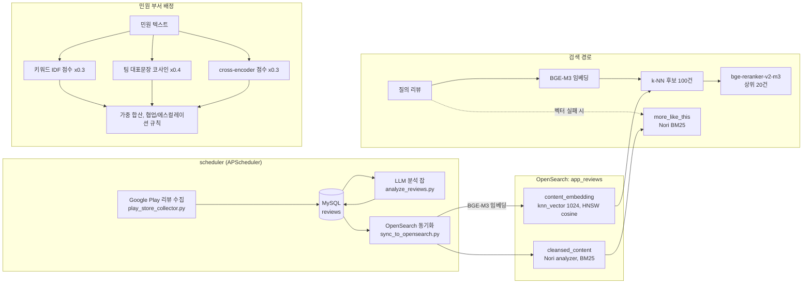

# korean-review-hybrid-retrieval

한국어 앱 리뷰를 대상으로 한 하이브리드 검색과 리랭크 예제입니다.

- OpenSearch Nori 형태소 분석(BM25)과 k-NN 벡터 검색(HNSW, cosine)
- BGE-M3 임베딩(1024차원)
- 키워드 IDF 점수와 임베딩 코사인 유사도의 가중 결합
- bge-reranker-v2-m3 cross-encoder 리랭크

리뷰 수집(Google Play), LLM 다중 에이전트 분석(감성, 카테고리, 민원), 민원 부서 배정, Flask API 까지 포함한 개인 프로젝트의 전체 코드 사본입니다.

## 공개본 안내

| 항목 | 처리 |
|---|---|
| 회사명, 앱 이름, 패키지 ID | 가명 처리 (`A은행`, `bank_a`, `com.example.bank_a` 형식) |
| 서버 주소, 계정, 비밀번호, API 키 | 환경변수로 교체. 값은 `.env.example` 에 비워 둠 |
| 수집한 리뷰 원문, DB 덤프, 워드클라우드 산출물 | 제외 |
| 실존 회사 로고와 로고 수집 스크립트 | 제외 |
| 에이전트 세션 기록, 개인 IDE 설정 | 제외 |
| 샘플 데이터 | `samples/` 의 가상 리뷰 36건, 가상 질의 5건 (직접 작성) |

- `app/config/department_hierarchy.yaml` 은 특정 회사가 아닌 일반적인 금융회사 조직도 예시입니다.
- 초기 버전의 셸과 SQL 배치(`legacy_Data_Batch/`)는 현재 파이프라인에서 쓰지 않아 공개본에서 제외했습니다.

## 구성도



## 핵심 코드 위치

| 기능 | 파일 |
|---|---|
| 인덱스 매핑 (Nori 분석기, knn_vector) | `app/services/review_service.py` (`REVIEW_INDEX_MAPPING`) |
| BGE-M3 임베딩 (API 우선, 로컬 sentence-transformers 대체) | `app/agents/embedding_service.py` |
| bge-reranker-v2-m3 리랭크 (API 우선, 로컬 FlagEmbedding 대체) | `app/agents/rerank_service.py` |
| 유사 리뷰 검색 (k-NN 후보 100건, 리랭크 후 20건, BM25 대체 경로) | `app/services/similar_review_service.py` |
| 부서 배정 하이브리드 점수 (0.3 키워드 + 0.4 임베딩 + 0.3 리랭크) | `app/services/department_routing_service.py` |
| OpenSearch 클라이언트 | `app/core/opensearch_client.py` |
| MySQL 에서 OpenSearch 로 동기화 | `scheduler/jobs/sync_to_opensearch.py` |
| 다중 LLM 클라이언트 (Gemini, Groq, Ollama, OpenAI, Azure OpenAI, 키 순환과 fallback) | `app/agents/llm_client.py`, `app/core/api_key_rotator.py` |

## 실행 방법

### 0. 준비

```bash
python -m venv .venv && source .venv/bin/activate
pip install -r requirements.txt
cp .env.example .env
# .env 에 OPENSEARCH_PASSWORD 를 채움 (대문자, 소문자, 숫자, 기호 포함 8자 이상)
```

- 첫 실행 때 Hugging Face 에서 `BAAI/bge-m3` 와 `BAAI/bge-reranker-v2-m3` 를 내려받습니다(합계 수 GB).
- `BGE_EMBEDDING_API_URL`, `BGE_RERANK_API_URL` 을 비워 두면 로컬 CPU 모델을 씁니다.

### 1. 부서 배정 데모 (인프라 불필요)

MySQL 이 없으면 YAML 조직도로 자동 전환합니다.

```bash
python scripts/demo_department_routing.py --file samples/queries_sample.txt
```

### 2. 유사 리뷰 검색 데모 (OpenSearch 필요)

```bash
docker compose up -d --build          # OpenSearch 2.15 + analysis-nori
python scripts/demo_index_samples.py --recreate
python scripts/demo_similar_search.py --file samples/queries_sample.txt
```

질의마다 Nori BM25 결과와 "k-NN 후 리랭크" 결과를 나란히 출력합니다.

### 3. 전체 시스템 (선택)

MySQL, Redis, LLM API 키가 필요합니다.

1. `migrations/`, `scripts/scheduler/schema/` 의 SQL 적용
2. 로그인 계정 생성: `ADMIN_USERNAME=... ADMIN_EMAIL=... ADMIN_PASSWORD=... python scripts/create_user.py --roles admin`
3. `scheduler/config/apps_config.yaml` 의 가상 패키지 ID 를 수집할 앱의 실제 ID 로 교체
4. 파이프라인 1회 실행: `python -m scheduler.main --run-pipeline`
5. API 서버: `./run.sh`

## 한계

- 검색 품질 정량 평가(nDCG, Recall 등)는 하지 않았습니다. 샘플 36건은 동작 확인용입니다.
- 리뷰 1건을 문서 1개로 색인합니다. 긴 문서용 청킹은 없습니다.
- BM25 와 k-NN 은 별도 경로입니다. 유사 리뷰 검색에서 두 점수를 하나의 순위로 합치지 않고, 벡터 검색이 실패할 때 BM25 로 대체합니다. 점수 가중 결합은 부서 배정에서 씁니다.
- 원본 저장소가 `*.html` 을 무시하도록 설정되어 있어 화면 템플릿 일부(`company_list`, `company_detail`, `complaint_board`, `dept_review`, `settings`)가 없습니다. 해당 화면 라우트는 템플릿을 추가해야 동작합니다. REST API 와 데모 스크립트는 영향이 없습니다.
- `tests/` 의 일부는 실제 Ollama, Azure OpenAI 엔드포인트가 있어야 하는 수동 점검 스크립트입니다.
- 인덱스 매핑은 `nmslib` 엔진을 씁니다. OpenSearch 3.x 에서는 `faiss` 또는 `lucene` 으로 바꿔야 합니다.
- `docs/` 의 문서는 개발 중 작성한 기록이라 일부 내용이 현재 코드와 다를 수 있습니다.

## License

Apache License 2.0. `LICENSE` 참고.

폰트 파일은 포함하지 않습니다. 워드클라우드에 한글을 표시하려면 한글 폰트를 직접 설치하고 경로를 `KOREAN_FONT_PATH` 환경변수로 지정하세요.

- 예: 나눔 폰트(SIL Open Font License 1.1, 배포판 패키지로 설치). Rocky/RHEL 계열 `dnf install google-nanum-fonts`, Debian/Ubuntu 계열 `apt install fonts-nanum`
- `KOREAN_FONT_PATH` 가 비어 있으면 시스템 기본 경로(Nanum, Noto CJK, AppleGothic, Malgun Gothic)를 차례로 찾습니다.
