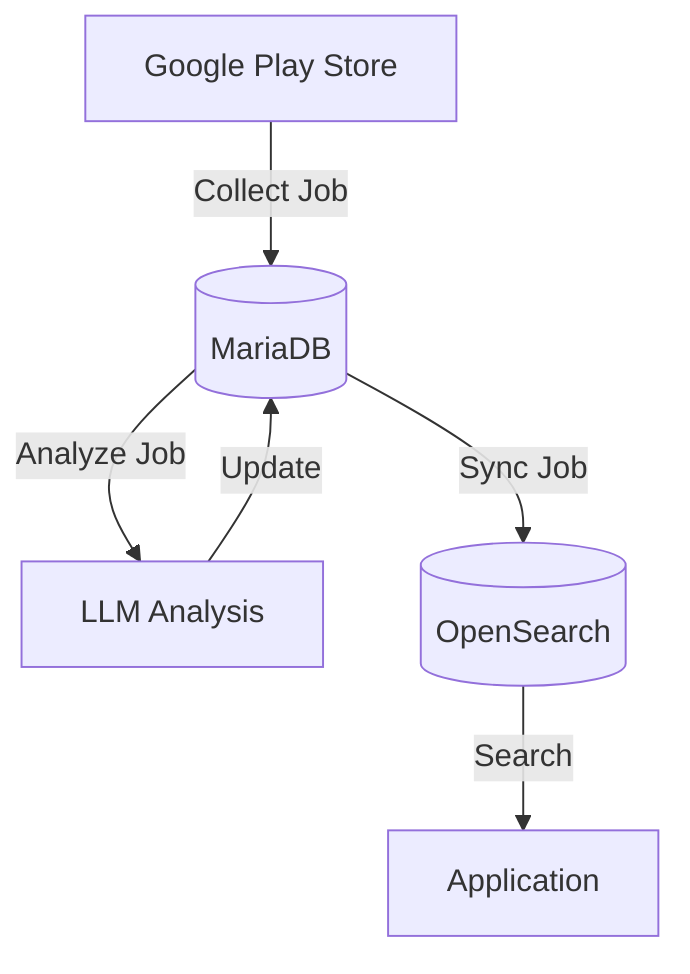

# 데이터 및 분석 파이프라인 (Data & Analysis Pipeline)

이 문서는 앱 리뷰 수집, 분석, 동기화 및 활용을 위한 전체 데이터 파이프라인의 구조와 흐름을 설명합니다.
최근 스케줄러 설계 결함 수정(2025-12-21)이 반영된 최신 아키텍처입니다.

## 1. 전체 파이프라인 개요

전체 파이프라인은 크게 **수집(Collect)**, **분석(Analyze)**, **동기화(Sync)**, **활용(Application)** 의 4단계로 구성됩니다.



## 2. 상세 데이터 흐름

### 2.1 수집 (Collect)
- **담당 모듈**: `scheduler.jobs.collect_reviews`
- **소스**: Google Play Store
- **타겟**: MariaDB (`reviews` 테이블)
- **동작**:
    - 주기적으로 리뷰를 수집하여 MariaDB에 저장합니다.
    - 저장 시 초기 상태: `analyzed = 0`, `synced_to_opensearch = 0`
    - **임베딩**: 이 단계에서는 생성하지 않습니다.

### 2.2 분석 (Analyze)
- **담당 모듈**: `scheduler.jobs.analyze_reviews`
- **소스**: MariaDB (`WHERE analyzed = 0`)
- **타겟**: MariaDB (`reviews` 테이블 업데이트)
- **동작**:
    1. MariaDB에서 미분석 리뷰(`analyzed=0`)를 조회합니다. (이전에는 OpenSearch에서 조회하던 결함 수정됨)
    2. LLM을 사용하여 감성(Sentiment), 불만(Complaint), 카테고리(Category)를 분석합니다.
    3. 분석 결과를 MariaDB에 업데이트합니다.
    4. 상태 변경: `analyzed = 1`
    - **주의**: 이 단계에서는 OpenSearch를 업데이트하지 않습니다. (Sync 작업이 담당)

### 2.3 동기화 (Sync)
- **담당 모듈**: `scheduler.jobs.sync_to_opensearch`
- **소스**: MariaDB (`WHERE synced_to_opensearch = 0 AND analyzed = 1`)
- **타겟**: OpenSearch (`app_reviews` 인덱스)
- **동작**:
    1. MariaDB에서 분석이 완료되었으나 동기화되지 않은 리뷰를 조회합니다.
    2. **임베딩 생성**: `review_service.index_reviews_bulk` 내부에서 `bge-m3-ko` 모델을 사용해 리뷰 내용의 벡터 임베딩(1024차원)을 생성합니다.
    3. 리뷰 데이터, 분석 결과, 임베딩 벡터를 OpenSearch에 인덱싱합니다.
    4. MariaDB의 동기화 상태를 업데이트합니다 (`synced_to_opensearch = 1`).

### 2.4 활용 (Application)
- **담당 모듈**: Flask Application (`app.services.review_service`)
- **소스**: OpenSearch
- **동작**:
    - 대시보드, 검색, 통계 등 모든 조회 기능은 OpenSearch를 사용합니다.
    - 텍스트 검색 및 벡터 검색(Semantic Search)을 활용합니다.

---

## 3. 데이터 저장소 구조

### 3.1 MariaDB (Source of Truth)
모든 원본 데이터와 분석 결과의 원천 저장소입니다.

| 필드 | 설명 |
|---|---|
| `review_id` | 리뷰 고유 ID |
| `content` | 리뷰 원문 |
| `analyzed` | 분석 완료 여부 (0/1) |
| `synced_to_opensearch` | OpenSearch 동기화 여부 (0/1) |
| `sentiment_label` | 감성 분석 결과 (positive/negative/neutral) |
| `is_complaint` | 불만 여부 (0/1) |
| ... | 기타 분석 필드 |

### 3.2 OpenSearch (Search Index)
검색과 통계를 위한 인덱스입니다.

| 필드 | 설명 |
|---|---|
| `review_id` | 리뷰 고유 ID |
| `sentiment` | 감성 분석 객체 (label, score 등) |
| `complaint` | 불만 분석 객체 (type, urgency 등) |
| `category` | 카테고리 분석 객체 |
| `content_embedding` | 벡터 검색용 임베딩 (1024 float array) |

---

## 4. 아스키 다이어그램 (상세 흐름)

```text
┌─────────────────────────────────────────────────────────────────────────────────┐
│                        스케줄러 파이프라인 전체 흐름                              │
└─────────────────────────────────────────────────────────────────────────────────┘

                              ┌─────────────────┐
                              │   Google Play   │
                              │     Store       │
                              └────────┬────────┘
                                       │
                                       ▼
┌──────────────────────────────────────────────────────────────────────────────────┐
│ 1. COLLECT (collect_reviews.py)                                                  │
│    ┌──────────────────────────────────────────────────────────────────────────┐  │
│    │  Google Play API → 리뷰 수집 → INSERT INTO reviews                       │  │
│    │                                (analyzed=0, synced_to_opensearch=0)      │  │
│    └──────────────────────────────────────────────────────────────────────────┘  │
└──────────────────────────────────────────────────────────────────────────────────┘
                                       │
                                       ▼
                              ┌─────────────────┐
                              │    MariaDB      │
                              │  (reviews)      │
                              └────────┬────────┘
                                       │
                                       ▼
┌──────────────────────────────────────────────────────────────────────────────────┐
│ 2. ANALYZE (analyze_reviews.py)                                                  │
│    ┌──────────────────────────────────────────────────────────────────────────┐  │
│    │  MariaDB (WHERE analyzed=0) 조회                                         │  │
│    │      ↓                                                                   │  │
│    │  LLM 분석 (sentiment, complaint, category)                               │  │
│    │      ↓                                                                   │  │
│    │  UPDATE reviews SET analyzed=1 ...                                       │  │
│    └──────────────────────────────────────────────────────────────────────────┘  │
└──────────────────────────────────────────────────────────────────────────────────┘
                                       │
                                       ▼
                              ┌─────────────────┐
                              │    MariaDB      │
                              │ (analyzed=1)    │
                              └────────┬────────┘
                                       │
                                       ▼
┌──────────────────────────────────────────────────────────────────────────────────┐
│ 3. SYNC (sync_to_opensearch.py)                                                  │
│    ┌──────────────────────────────────────────────────────────────────────────┐  │
│    │  MariaDB (WHERE synced=0 AND analyzed=1) 조회                            │  │
│    │      ↓                                                                   │  │
│    │  임베딩 생성 (EmbeddingService, bge-m3-ko)                               │  │
│    │      ↓                                                                   │  │
│    │  OpenSearch bulk index (데이터 + 분석 + 임베딩)                           │  │
│    │      ↓                                                                   │  │
│    │  UPDATE reviews SET synced_to_opensearch=1                               │  │
│    └──────────────────────────────────────────────────────────────────────────┘  │
└──────────────────────────────────────────────────────────────────────────────────┘
                                       │
                                       ▼
                              ┌─────────────────┐
                              │   OpenSearch    │
                              │  (app_reviews)  │
                              └────────┬────────┘
                                       │
                                       ▼
┌──────────────────────────────────────────────────────────────────────────────────┐
│ 4. APPLICATION                                                                   │
│    ┌──────────────────────────────────────────────────────────────────────────┐  │
│    │  OpenSearch 검색 및 시각화                                                │  │
│    └──────────────────────────────────────────────────────────────────────────┘  │
└──────────────────────────────────────────────────────────────────────────────────┘
```
