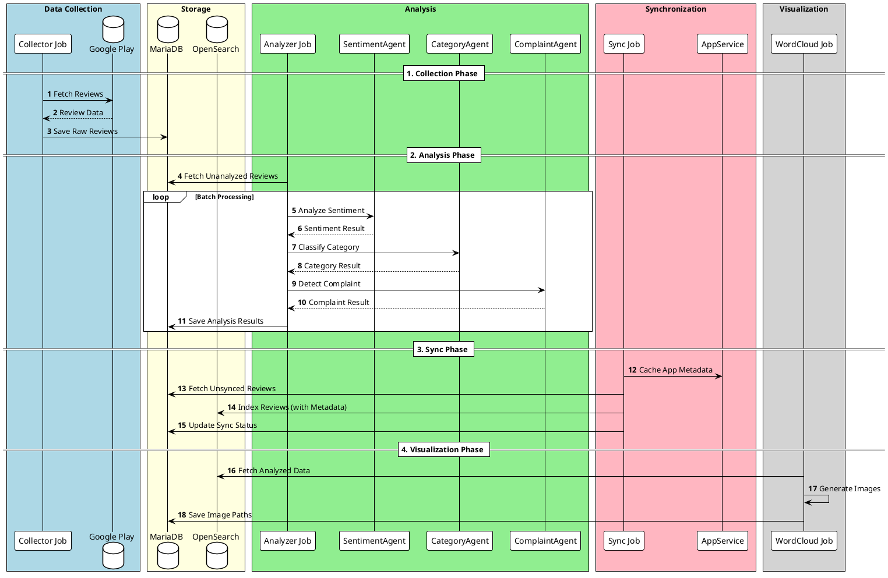

# 스케줄러 실행 가이드

## 실행 모드 (3가지)

### 1. Daemon 모드 (기본) - 계속 실행
```bash
python -m scheduler.main
```

**동작:**
- 백그라운드에서 계속 실행
- 설정된 스케줄에 따라 자동 실행
- Ctrl+C로 중지

**스케줄 예시 (scheduler_config.yaml):**
- collect_reviews: 4시간/8시간/24시간 간격
- analyze_reviews: 1시간 간격 (Sentiment, Category, Complaint 분석)
- sync_to_opensearch: 5분 간격 (App Metadata 포함)
- generate_wordcloud: 매일 오전 3시

---

## 스케줄러 워크플로우 (Scheduler Workflow)



---

### 2. Pipeline 모드 - 전체 파이프라인 1회 실행 ⭐ NEW
```bash
python -m scheduler.main --run-pipeline
```

**동작 순서:**
```
[1/4] collect_reviews (high → medium → low)
  ↓
[2/4] analyze_reviews  
  ↓
[3/4] sync_to_opensearch
  ↓
[4/4] generate_wordcloud
```

**예상 출력:**
```
============================================================
Starting Full Data Pipeline
============================================================

[1/4] Collecting reviews...
  - Priority: high
  - Priority: medium
  - Priority: low

[2/4] Analyzing reviews...

[3/4] Syncing to OpenSearch...

[4/4] Generating word clouds...

============================================================
Pipeline Completed Successfully!
============================================================

Pipeline result: True
```

**사용 케이스:**
- 초기 데이터 로드
- 수동 전체 재처리
- 테스트/검증
- CI/CD 파이프라인

---

### 3. Single Job 모드 - 특정 Job 1회 실행
```bash
# 리뷰 수집 (우선순위별)
python -m scheduler.main --run-once collect_high
python -m scheduler.main --run-once collect_medium
python -m scheduler.main --run-once collect_low

# 리뷰 분석
python -m scheduler.main --run-once analyze

# OpenSearch 동기화
python -m scheduler.main --run-once sync_to_opensearch

# 워드클라우드 생성
python -m scheduler.main --run-once wordcloud

# [옵션] 전체 과거 데이터 수집 (초기 구축용)
# --fetch-all 옵션을 추가하면 설정된 개수 제한(200개)을 무시하고 모든 과거 리뷰를 수집합니다.

# 방법 1: 통합 명령어 사용 (권장)
python -m scheduler.main --run-once collect --fetch-all

# 방법 2: 우선순위별 개별 실행
python -m scheduler.main --run-once collect_high --fetch-all
python -m scheduler.main --run-once collect_medium --fetch-all
python -m scheduler.main --run-once collect_low --fetch-all

# 방법 3: 분석 및 동기화 전체 처리 ⭐ NEW
# 대기 중인 모든 항목을 배치 단위로 반복 처리합니다.
python -m scheduler.main --run-once analyze --fetch-all
python -m scheduler.main --run-once sync_to_opensearch --fetch-all
```

### `--fetch-all` 옵션 지원 현황

| 작업 (Job) | 명령어 (`--run-once`) | `--fetch-all` 동작 |
| :--- | :--- | :--- |
| **리뷰 수집 (전체)** | `collect` | 설정된 개수 제한 무시하고 가능한 모든 과거 리뷰 수집 |
| **리뷰 수집 (High)** | `collect_high` | High 우선순위 앱의 모든 과거 리뷰 수집 |
| **리뷰 수집 (Medium)** | `collect_medium` | Medium 우선순위 앱의 모든 과거 리뷰 수집 |
| **리뷰 수집 (Low)** | `collect_low` | Low 우선순위 앱의 모든 과거 리뷰 수집 |
| **리뷰 분석** | `analyze` | 대기 중인(미분석) 모든 리뷰를 배치 단위로 반복 처리 |
| **OpenSearch 동기화** | `sync_to_opensearch` | 대기 중인(미동기화) 모든 리뷰를 배치 단위로 반복 처리 |
| **워드클라우드** | `wordcloud` | 지원 안함 (설정된 기간 데이터로 생성) |

**사용 케이스:**
- 개별 Job 디버깅
- 수동 실행
- 크론탭 등록

---

## 유틸리티 명령어

### 설정 검증
```bash
python -m scheduler.main --validate
```

**출력 예시:**
```
Configuration validation:
  Scheduler config: OK
  Apps configured: 68
  Jobs enabled:
    - collect_reviews: enabled
    - analyze_reviews: enabled
    - generate_wordcloud: enabled

Configuration is valid!
```

### 앱 목록 확인
```bash
python -m scheduler.main --list-apps
```

### 상태 확인 스크립트 ⭐ NEW
```bash
./scripts/status_scheduler.sh
```

**출력 예시:**
```
=== Scheduler Job Status ===
Checking for running scheduler jobs...
----------------------------------------
Found running jobs:

PID        USER       START      COMMAND                                           
--------------------------------------------------------------------------------
12345      appuser     10:00      analyze (ALL)                                     
67890      appuser     10:05      collect_high (NORMAL)                             
----------------------------------------
```
- `(ALL)`: `--fetch-all` 옵션으로 실행 중 (전체 처리)
- `(NORMAL)`: 일반 모드로 실행 중 (배치 제한 적용)

---

## 실행 시나리오

### 시나리오 1: 초기 배포
```bash
# 1. 설정 검증
python -m scheduler.main --validate

# 2. 전체 파이프라인 1회 실행 (초기 데이터 로드)
python -m scheduler.main --run-pipeline

# 3. Daemon 모드 시작 (이후 자동 실행)
nohup python -m scheduler.main > logs/scheduler.log 2>&1 &
```

### 시나리오 2: 수동 재처리
```bash
# 특정 우선순위만 재수집
python -m scheduler.main --run-once collect_high

# 분석 실행
python -m scheduler.main --run-once analyze

# OpenSearch 동기화
python -m scheduler.main --run-once sync_to_opensearch
```

### 시나리오 3: 정기 점검
```bash
# 전체 파이프라인 재실행 (크론탭 등록)
0 2 * * 0 cd <PROJECT_ROOT> && python -m scheduler.main --run-pipeline
```

---

## 환경변수

```bash
# 스케줄러 설정
SCHEDULER_CONFIG=scheduler/config/scheduler_config.yaml
APPS_CONFIG=config/apps_config.yaml

# 데이터베이스
SCHEDULER_DB_HOST=localhost
SCHEDULER_DB_PORT=3306
SCHEDULER_DB_USER=root
SCHEDULER_DB_PASSWORD=<set-in-.env>
SCHEDULER_DB_NAME=app_reviews_scheduler

# OpenSearch (동기화 Job용)
OPENSEARCH_HOSTS=https://localhost:9200
OPENSEARCH_USER=admin
OPENSEARCH_PASSWORD=<set-in-.env>
```

---

## 로그 확인

```bash
# 실시간 로그
tail -f logs/scheduler.log

# Pipeline 실행 중 로그 필터
tail -f logs/scheduler.log | grep -E "Pipeline|Stage|Collecting|Analyzing|Syncing"

# 에러 로그만
tail -f logs/scheduler.log | grep ERROR
```

---

## 트러블슈팅

### Pipeline 모드가 실행되지 않음
```bash
# 원인: sync_to_opensearch job 미등록
# 해결: scheduler_config.yaml에 job 추가

jobs:
  sync_to_opensearch:
    enabled: true
    schedule:
      trigger: "interval"
      minutes: 5
```

### Single Job 실행 시 "Unknown job" 에러
```bash
# 잘못된 job 이름 사용
python -m scheduler.main --run-once invalid_job

# 올바른 job 이름 확인
python -m scheduler.main --help
```

### Daemon 모드가 중지되지 않음
```bash
# 프로세스 찾기
ps aux | grep "scheduler.main"

# 강제 종료
pkill -f "scheduler.main"
```

---

## 성능 고려사항

### Pipeline 모드 실행 시간 예상
- collect_reviews: ~30분 (68개 앱 기준)
- analyze_reviews: ~10분  
- sync_to_opensearch: ~5분
- generate_wordcloud: ~3분
**총 예상 시간: ~48분**

### 리소스 사용
- CPU: 중간 (분석/워드클라우드 시 높음)
- 메모리: ~2GB
- 디스크 I/O: 중간 (수집/동기화 시 높음)
- 네트워크: 중간 (PlayStore API, OpenSearch)

---

## Help 명령어
```bash
python -m scheduler.main --help
```

**출력:**
```
usage: main.py [-h] [--config CONFIG] [--list-apps] [--validate] 
               [--run-pipeline]
               [--run-once {collect_high,collect_medium,collect_low,analyze,wordcloud,sync_to_opensearch}]

Review Collection and Analysis Scheduler

optional arguments:
  -h, --help            show this help message and exit
  --config CONFIG       Path to scheduler configuration file
  --list-apps           List all configured apps and exit
  --validate            Validate configuration and exit
  --run-pipeline        Run full data pipeline once (collect → analyze → sync → wordcloud) and exit
  --run-once {collect_high,collect_medium,collect_low,analyze,wordcloud,sync_to_opensearch}
                        Run a specific job once and exit

Execution Modes:
  Daemon Mode (default):
    python -m scheduler.main
    
  Pipeline Mode (run full pipeline once):
    python -m scheduler.main --run-pipeline
    Executes: collect → analyze → sync → wordcloud
    
  Single Job Mode:
    python -m scheduler.main --run-once <job>
    
  Validation:
    python -m scheduler.main --validate
```


```
# ① 리뷰 수집 (Google Play → MySQL)
cd <PROJECT_ROOT> && nohup python -u -m scheduler.main --run-once collect --fetch-all > logs/scheduler_collect.log 2>&1

# ② 리뷰 분석 (MySQL의 미분석 리뷰 → LLM 분석 → MySQL 업데이트)
cd <PROJECT_ROOT> && nohup python -u -m scheduler.main --run-once analyze --fetch-all > logs/scheduler_analyze.log 2>&1

# ③ OpenSearch 동기화 (MySQL → OpenSearch 인덱싱)
cd <PROJECT_ROOT> && nohup python -u -m scheduler.main --run-once sync --fetch-all > logs/scheduler_sync.log 2>&1

# ④ 마트 집계 (대시보드용 통계 테이블 갱신)
cd <PROJECT_ROOT> && nohup python -u -m scheduler.main --run-once aggregate_mart > logs/scheduler_mart.log 2>&1

# ⑤ 워드클라우드 생성 (daily/weekly/monthly 워드클라우드 이미지)
cd <PROJECT_ROOT> && nohup python -u -m scheduler.main --run-once wordcloud > logs/scheduler_wordcloud.log 2>&1

```